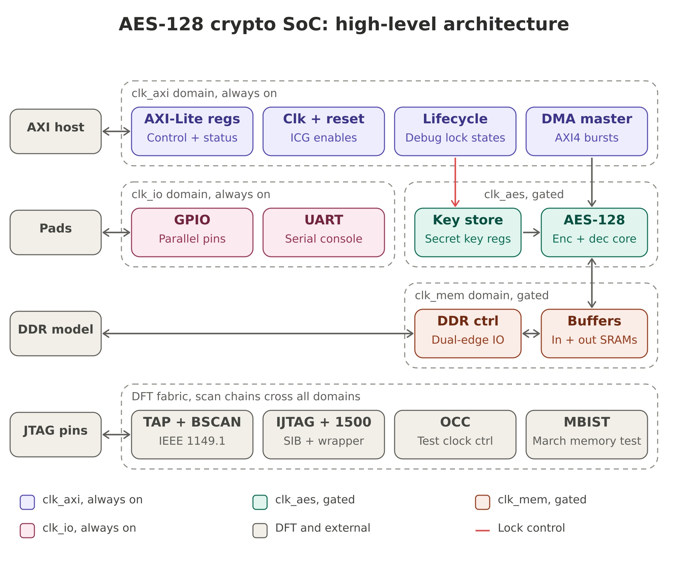

# aes-dft-soc

A learning project: take a small AES-128 crypto SoC through a complete Design-for-Test flow, the way a DFT team does in industry, and document every step.

## Goals
- Design a small but realistic crypto SoC (AES-128 core, AXI, four clock domains with two gated, memories, DDR-style controller, IO).
- Implement DFT on it: scan insertion, ATPG, boundary scan (IEEE 1149.1), IEEE 1500 wrapper, IJTAG (IEEE 1687) network, on-chip clock control, MBIST, and secure test access.
- Verify each feature with a UVM-based environment.
- Document design choices, alternatives rejected, results and lessons for every feature.

## Architecture

## Repository layout
| Path | Contents |
|---|---|
| `rtl/` | Synthesizable RTL, one folder per block (`rtl/aes/` first) |
| `tb/` | Testbenches and UVM environments |
| `scripts/` | Flow scripts (synthesis, scan, ATPG, simulation) |
| `docs/` | Specs and per-feature documentation, see [docs/README.md](docs/README.md) |

## Tools
- Vivado xsim on Windows: RTL simulation, SystemVerilog assertions, UVM.
- Linux: Yosys (synthesis), Fault and/or OpenROAD DFT (scan insertion, ATPG), Icarus Verilog / Verilator (gate-level simulation), sky130 standard cells.

## Status
See [docs/project-roadmap.md](docs/project-roadmap.md). Currently in the AES functional design phase; DFT planning comes after the functional design is frozen.
